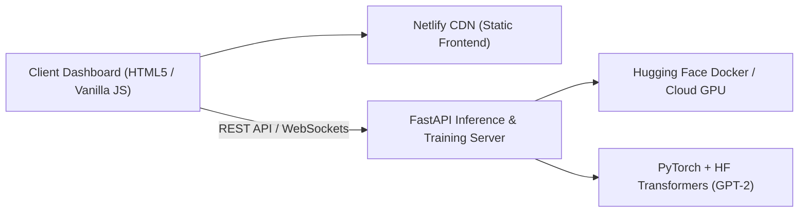

# 🧠 Custom-Style GPT-2 Fine-Tuning Lab

[](https://opensource.org/licenses/MIT)
[](https://www.python.org/)
[](https://pytorch.org/)
[](https://huggingface.co/)
[](https://fastapi.tiangolo.com/)
[](https://www.netlify.com/)

> **An interactive full-stack laboratory for training, fine-tuning, and evaluating custom autoregressive language models (GPT-2) with synthetic datasets, hyperparameter tuning, and real-time generation previews.**

---

## 📖 Overview

The **Custom-Style GPT-2 Fine-Tuning Lab** demystifies LLM fine-tuning by providing an end-to-end sandbox. It bridges the gap between raw Python PyTorch scripts and an intuitive visual dashboard:
1. **Dataset Lab**: Inspect, filter, and validate synthetic training datasets (CSV/JSON).
2. **Training Studio**: Configure training epochs, learning rates, batch sizes, and warm-up steps with live loss tracking.
3. **Generation Lab**: Test prompt completions, adjust temperature/top_k/top_p, and evaluate style transfer in real-time.

---

## 🏗️ Architecture



---

## 🛠️ Tech Stack

- **Frontend**: Vanilla JavaScript (ES6+), CSS3 Dark Mode Theme, Netlify CDN
- **Backend API**: FastAPI, Uvicorn, Python 3.10+
- **Deep Learning**: PyTorch, Hugging Face `transformers`, `datasets`, `accelerate`
- **Deployment**: Docker, Hugging Face Spaces / Cloud VM

---

## 📁 Repository Structure

```text
gpt-finetune-lab/
├── app.js                      # Reactive frontend UI controller
├── app.py                      # FastAPI server handling training & inference
├── index.html                  # Multi-panel interactive studio UI
├── styles.css                  # Dark-mode dashboard stylesheet
├── requirements.txt            # Python dependencies
├── Dockerfile                  # Container definition for backend host
├── synthetic_text_dataset.csv  # Curated synthetic domain dataset
├── netlify.toml                # Netlify deployment rules
├── LICENSE                     # MIT License
└── README.md                   # Project documentation
```

---

## 🚀 Getting Started

### 1. Run Backend Locally
```bash
# Clone the repository
git clone https://github.com/MahirMavani/gpt-finetune-lab.git
cd gpt-finetune-lab

# Install Python dependencies
pip install -r requirements.txt

# Launch FastAPI server
uvicorn app:app --host 0.0.0.0 --port 7860 --reload
```

### 2. Run Frontend
Open `index.html` in your browser, or serve it locally using any static web server (e.g. `npx serve .`). Enter `http://localhost:7860` as the backend endpoint.

---

## 🤝 Contributing

Contributions are welcome! Please open an issue or submit a PR.

---

## 📄 License

This project is licensed under the [MIT License](LICENSE).
